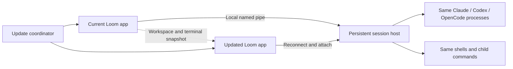

# Study: update Loom while its sessions keep running

Study only. No implementation or installation changes. Reviewed on 2026-09-26
against commit `adf4df2`.

The requested result is an **Update now** action inside Loom. The updated
application becomes usable after a brief automatic handover, while the same
agents, shells, and their child commands continue running.

This is feasible by separating terminal ownership from the desktop application.
It is not possible to promise that every component, including the process that
owns live terminal handles, changes its running code at once. That distinction
defines the first release and its cost.

## What the code does today

| Component | Current behavior | Consequence |
| --- | --- | --- |
| `src-tauri/src/lib.rs`, `Session`, `Ptys`, `pty_spawn` | The desktop process owns ConPTY handles, input writers, child handles, and output reader threads. | Restarting the desktop process also loses terminal ownership. |
| `pty_spawn` output delivery | Sends output through a Tauri channel. There is no retained output journal or reconnect cursor. | A new UI cannot recover output from a disconnected channel. |
| `pty_shutdown` and the main-window destruction handler | Kill the sessions and their process trees. | Updating must have a detach path separate from explicit quit. |
| `src/main.ts`, `Pane.start`, `spawn` | Recreate panes and launch processes when restoring a workspace. | Conversation resume is not attachment to a running process. |
| `PaneState`, `flushSave` | Save conversation IDs, commands, layout, preferences, diff tabs, commit drafts, and other workspace state. | Much persistence is reusable, but stable pane IDs, terminal buffers, and several drafts are missing. |
| `src-tauri/tauri.conf.json` | Embeds the frontend bundle in the executable. | Refreshing the old WebView does not load the new executable's embedded assets. |
| `scripts/update.ps1` | Builds, stages, checks hashes, replaces the executable, and retains a backup. | Useful installation logic, but no session attachment, readiness handshake, or application rollback. |

Closing a Windows pseudoconsole closes its attached client applications. The
host must continue reading output while the UI is unavailable. These are
constraints of the console API, not just Loom's current shutdown behavior.
[Microsoft pseudoconsole lifecycle documentation](https://learn.microsoft.com/en-us/windows/console/creating-a-pseudoconsole-session).

The existing browser-serve study and the separate phone-remote study are related
plans. Neither currently supplies an implemented session host. Their estimates
do not cover a complete native application handover with display preservation
and rollback.

## Recommended architecture

Use a hidden, per-user Rust process named `loom-session-host.exe`. Start one for
each workspace profile as needed. It owns the terminals and survives application
replacement. It does not open a WebView or require an administrator-installed
Windows service. Reuse the existing Rust terminal code and dependencies.

The host needs a small versioned protocol for creating, listing, attaching to,
writing to, resizing, and closing sessions. Output chunks and exit events need
sequence numbers. Pane identity must survive application reloads and remain
distinct from the provider's conversation ID and the Windows process ID.

Keep the existing frontend-to-Tauri calls where practical. A native client
forwards terminal operations to the host. Add an explicit attach path; failure
to attach must never silently spawn a second agent.

Use Windows named pipes with an explicit user/logon ACL, reject remote clients,
and validate message sizes, session IDs, and the takeover credential. The
default named-pipe security descriptor grants read access more broadly than
this terminal service should allow.
[Microsoft named-pipe security documentation](https://learn.microsoft.com/en-us/windows/win32/ipc/named-pipe-security-and-access-rights).

The host grants one app permission to send input and save authoritative workspace
state. A successor can prepare in read-only mode. It gains control through an
acknowledged handover, preventing two windows from submitting input or consuming
the same notification markers.

## What Update now would do

1. Obtain and stage the new version while the current app remains usable. The
   first release can accept a locally built package. Building inside Loom would
   additionally require a configured checkout and the existing build tools.
2. Verify package integrity and app/host protocol compatibility. Refuse an
   incompatible update before detaching anything.
3. Reach a safe boundary for an input submission, dictation, or native operation
   already in progress. Running terminal agents do not need to finish their work.
4. Freeze new UI input briefly. Capture workspace drafts and a terminal snapshot
   tied to an exact output position. Continue draining terminal output into the host.
5. Launch the updated app with an authenticated takeover token and the same
   profile. Bypass the normal single-instance behavior only for this handover.
6. Restore the snapshots, replay later output in order, and confirm readiness.
   Transfer input ownership and show the new app. Only then retire the old app.
7. If startup or restoration fails, return ownership to the old app. If the old
   app has already exited, relaunch its retained version against the same host.

The coordinator must outlive the retiring app. Staged app versions, a retained
previous version, and rollback-readable workspace data make recovery possible.
Do not commit a destructive state migration before the replacement is healthy.

**Immediate means an automatic switch to the updated app.** Downloading or
compiling still takes time. A 1–3 second interruption of UI interaction is a
target to measure, not a guarantee. Agent processes remain alive throughout.

## What preserving work includes

| State | First-release contract |
| --- | --- |
| Running agents, shells, and their child commands | Same process IDs; no resume/relaunch substitution. |
| Terminal screen, cursor, colors, normal/alternate buffers, and input modes | Restore with the original dimensions, then resize to the new window. |
| Retained history and scroll position | Preserve the history Loom currently retains: 1,500 agent lines and 5,000 shell lines. This is not unlimited lifetime history. |
| Prompt already typed into a terminal | Keep it in the running process and restore its visible state. Do not retype it. |
| Overview replies, commit drafts, editable forms, selected tabs, and pane layout | Snapshot drafts and stable identities before handover. |
| Waiting alerts, elapsed times, and overlay state | Restore once, without sounding old notifications again. |
| Keep-PC-awake preference | Maintain the request in the persistent host or transfer ownership without a gap. |
| Recording, transcription, and app-owned Git operations | Wait for a safe boundary before switching; never silently cancel or blindly retry them. |

Keeping a PTY alive alone does not satisfy this contract. xterm processes writes
asynchronously. A snapshot must identify the last output it actually processed,
and the new app must replay only output after that point.

Evaluate the maintained `@xterm/addon-serialize` before writing a serializer. It
supports restoring terminal rows, cursor positioning, modes, and the alternate
buffer, but upstream labels it experimental. It is not proof that every parser
state survives a snapshot. Split escape sequences, Unicode, terminal queries,
and full-screen applications belong in the prototype.
[xterm serializer documentation](https://github.com/xtermjs/xterm.js/tree/master/addons/addon-serialize),
[serializer API](https://raw.githubusercontent.com/xtermjs/xterm.js/master/addons/addon-serialize/typings/addon-serialize.d.ts).

During replay, suppress historical notification side effects and terminal
responses that were already sent. A snapshot taken inside an incomplete control
sequence needs a verified continuation strategy. Do not assume a ring of recent
text can reconstruct a terminal.

The host must retain output produced during disconnection without allowing a
slow renderer to grow memory indefinitely. Use bounded memory with a temporary
disk backlog and explicit pressure handling. If resources run out, preserve
sessions and report the blocked handover; do not silently discard output.
No finite system can promise unlimited output retention during an unlimited
disconnection. xterm also needs acknowledgement-based delivery so catch-up does
not overflow its input queue.
[xterm flow-control guide](https://xtermjs.org/docs/guides/flowcontrol/).

## Installation and compatibility constraints

- **One initial migration:** the currently installed monolithic version cannot
  retroactively move its live terminals into a host it never started. Plan the
  initial restart after current work finishes. Subsequent updates use attachment.
- **Host updates:** app UI and native client updates can activate immediately if
  compatible with the running host. A host fix cannot replace the code already
  executing inside that host. Initially, upgrade it after its sessions finish.
  Routing old sessions to host v1 and new sessions to host v2 is a later extension.
- **Installer process matching:** the generated NSIS installer checks for and can
  terminate `loom.exe` by name. Naming the host `loom.exe --host` would expose it
  to that behavior. Use a distinct host filename and a controlled live-update
  path. Do not run the stock installer blindly during handover.
- **Helper paths:** current session setup embeds `current_exe()` in Claude and
  Codex helpers. Retain every executable and hook configuration that a live
  session references, or introduce a stable compatible helper entry point.
- **Single-instance and profiles:** normal launches should still focus the
  existing window. Only a validated successor may take over. Keep dev, default,
  and explicit workspace profiles isolated.
- **Failure scope:** this design preserves work across application updates and
  application failure. It does not checkpoint arbitrary agent memory across a
  session-host crash, Windows restart, or power loss.

For future online distribution, reuse established signature verification and
release metadata. Tauri's updater requires update signatures and exits the
Windows app before installation; the plugin does not provide session continuity.
Its installation path would need to respect the host lifetime and rollback
design. Update signatures and Windows Authenticode certificates serve different
purposes. Buying an Authenticode certificate is not required for a local update
workflow.
[Tauri updater documentation](https://v2.tauri.app/plugin/updater/).

## Estimated cost

These are engineering estimates from code inspection, not measured delivery
times or a fixed quote. Assume one experienced Rust/Windows/TypeScript engineer,
Windows-only delivery, a local update package, and reuse of Loom's existing UI.

| Work | Focused engineering days |
| --- | ---: |
| Prototype the host, detach/attach, and terminal snapshot boundary | 2–3 |
| Complete host extraction, local protocol, lifecycle, and access control | 5–8 |
| Complete terminal/workspace restoration and input handover | 5–8 |
| In-app update, installation coordination, readiness checks, and rollback | 3–6 |
| Failure tests, repeated updates, profile isolation, and regression work | 4–7 |
| **Subtotal** | **19–32** |
| **Planning budget with contingency** | **20–35** |

Budget roughly **4–7 working weeks**, or **160–280 hours** at eight hours per
day. The prototype is included, not an extra charge. Public signed release
delivery adds approximately **2–4 days**, excluding an organization's release
approval processes. Keeping active dictation and every native job uninterrupted
through the switch requires further extraction; allow an additional **3–7 days**
as a provisional estimate, then revise after the prototype.

For an external developer, multiply hours by the agreed rate. At an illustrative
$50/hour the planning range is $8,000–$14,000; at $100/hour it is $16,000–$28,000.
These example rates are arithmetic assumptions, not market-rate research.

Local updating requires no cloud service or paid hosting subscription. Online
distribution needs storage/bandwidth and signing-key management; provider costs
depend on download volume and are not priced here. Ongoing maintenance includes
protocol compatibility and the live-session regression test on each release.

Runtime costs must be measured in the prototype:

| Resource | Planning implication |
| --- | --- |
| Processes | One extra headless host per active workspace profile. Existing agents are not duplicated. |
| Memory | Host memory plus snapshots and pending output. A chosen 4 MiB queue for each of 20 panes alone costs 80 MiB; this is a capacity example, not a prediction of total RAM. |
| CPU | Blocking I/O should make idle overhead small. Output copying, checksums, snapshots, and replay add work while active. No benchmark yet. |
| Handover peak | Two app/WebView processes may overlap briefly to permit validation and rollback. |
| Disk | Retained app/host versions, checkpoints, and temporary output backlog. The current local release executable is about 5 MiB. Share existing models rather than copying them per version. |
| Latency | Target 1–3 seconds of UI handover, after staging. The recent local release build took 1 minute 33 seconds; future build and download times vary. |

## Prototype gate before building the full feature

Use disposable real Windows PTYs and a replacement native app, not only mocked
browser IPC. Keep the current installed Loom untouched during development.

The prototype must prove:

1. Shell/agent PIDs and start times remain unchanged across app replacement.
2. Continuous numbered output has no gaps or duplicate delivery at the boundary.
3. Unsubmitted input, alternate-screen state, terminal modes, cursor, and retained
   history survive. Include Unicode and a control sequence split at handover.
4. A submitted command executes exactly once; no uncertain input is retried.
5. A bad package or failed build leaves the old app usable. A replacement that
   crashes before readiness allows the old app to reconnect to the same sessions.
6. A client disconnect does not stop output drainage, helpers, or terminal queries.
7. Repeat updates, multiple profiles, and delayed/high-volume output work within
   explicit resource budgets. Unauthorized clients cannot control the host.

Reuse `scripts/scroll-check.mjs`, `scripts/ui-check.mjs`, the native profile/CDP
test pattern, and `scripts/update-check.ps1`. The current updater test proves
file replacement preserves a disposable running process; it does not prove
ConPTY continuity or full application handover. Only this study was produced;
no new prototype measurements or success claims are implied.

**Recommendation:** fund the 2–3 day prototype first. Build the full in-app
feature after it proves process, input, and display continuity. Keep host upgrades
outside the first release's immediate-update promise.
