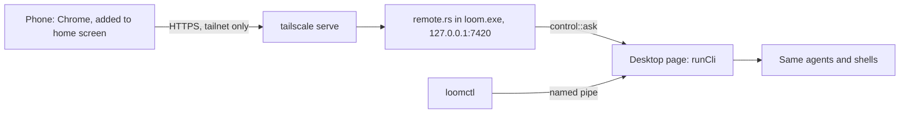

# Study: all of Loom from the phone

Written 2026-10-06 against `6d460c4`. Phase 1 is built on `loom/mobile`:
`src-tauri/src/remote.rs`, `remote.html`, `src/remote.ts` and `loomctl remote`.
Setup is in the README and `docs/loomctl.md#phone-remote`.

The goal: open one address on the Android phone, at home or away, and do
everything Loom does. See every agent, read its screen, prompt it, answer its
questions, start threads and panes, review and commit changes. The agents keep
running on the PC. No paid services.

A first version of this study was written on 2026-09-26 in the `loom/remote`
worktree. It was never committed and went with the worktree. This one starts
again from the current code, which now has loomctl and changes the answer.

## What you use today

| Way in | What it gives | What hurts |
| --- | --- | --- |
| Chrome Remote Desktop plus Loom's phone window (`window phone`) | Everything, since it is the real desktop | The whole desktop scaled to a phone. Small targets, lag, no alert that opens a given agent |
| `claude --rc` in the Claude app | A real conversation with one Claude pane | Claude panes only, one at a time, no threads or Codex/OpenCode |
| The `loom-watch` mod: `/loom` in the Claude app, ntfy alerts | A numbered pane list and alerts on the phone | Text only. Runs only while its Claude Code session runs, and every action costs a Claude turn |
| `ASH-LOOM-EVENT` mail to Ash | Finish, fail and approval outcomes | One-way. Leave it as it is |

None of them is "Loom, on the phone". Remote desktop comes closest and is the
one to replace for day-to-day agent work.

## The fact that decides the design

The page is the brain. `control.rs:1-5` says it: loomctl's commands "run in
the page, where the threads and panes live". Threads, panes, tasks and the
workspace file all belong to `main.ts` in the desktop window. Rust holds the
terminals and carries messages.

That leaves two designs.

1. **Serve the desktop page to the phone** (`docs/browser-serve-study.md`). The
   phone would run a second copy of `main.ts`. It would load the same
   `workspaces.json` and start its own agents instead of attaching to the
   running ones. Making it attach needs the session host from
   `docs/live-update-study.md`, which is weeks of work. Not now.
2. **A phone page that drives the desktop page through loomctl.** loomctl
   already reaches about 35 commands, and each runs through the same functions
   as the buttons (`runCli`, `main.ts:8705`). In Rust, one function takes
   `{cmd, argv}` and returns the page's answer: `control::ask`
   (`control.rs:258`). An HTTP route that calls it gives the phone every
   command, `--key` retries included, without a second API.

I recommend 2. The desktop window stays the only brain, so the phone, the
desktop and loomctl can never disagree.

## Recommended architecture

### Rust: `remote.rs`, about 150 lines

- A `tokio` `TcpListener` on `127.0.0.1` only. `tokio` with `net` is already a
  dependency (`Cargo.toml:53`). Two routes don't need a framework, so parse the
  HTTP/1.1 request line, headers and `Content-Length` by hand.
- `GET /` and `/assets/*` come from the bundle embedded in `loom.exe` through
  `app.asset_resolver()`. Vite gets a third entry, `remote.html`, beside
  `overlay.html` (`vite.config.ts:14`).
- `POST /api/cli` with `{cmd, argv, stdin, key}` calls `control::ask` and
  returns its JSON. Gzip the answer with `flate2`, already in `Cargo.lock`.
- Off until you turn it on: `loomctl set remote on|off`.

### Phone page: `remote.html` and `src/remote.ts`, about 400 lines

| Screen | Commands it calls |
| --- | --- |
| Agents, waiting first, with thread, agent, title, state and age | `panes --json` every 2 s while the page is visible |
| One agent's screen | `read --styles` (`styledRows`, `main.ts:3268`), fetched again only when the pane's `lastOutput` moves; `read --lines 300` for history |
| Prompt box | `submit`, which returns a task id the page follows to the end |
| Question buttons | `menu`, then `choose --menu ID`, which refuses if the question changed |
| Key bar: Esc, Ctrl+C, up, down, Tab, Enter, 1 to 4 | `keys` |
| New thread: known project, agent, name, base | `new <folder> --agent A --name N --base B`, which cuts the worktree (`main.ts:8196`) |
| Thread menu | `add`, `restart`, `stop`, `close`, `rename`, and `close-thread` after showing `close-plan` |
| Settings | `notify`, `set awake`, `usage`, `theme` |

Targets stay big. You found small controls hard to hit through remote desktop,
and a phone page has no excuse for them.

### Readable terminals

I read this pane's screen while writing this: 40 rows, 134 columns. A phone
shows about 50 columns at a readable size. Claude and Codex wrap their output
at the terminal's width, so the phone can't re-wrap it afterwards.

The fix is already in Loom. When the phone opens an agent, the page calls
`window phone` (`phoneWindow`, `main.ts:31`) once, then `show` and `zoom` on
that pane. The pane gets the phone-shaped window, the agent redraws to that
width, and the phone draws the rows as they come. The desktop follows the
phone, so when you sit back down it shows what you were doing, and `window
phone` again restores the desktop size. Phase 0 measures the column count this
gives; the phone's font size is the knob if it is off.

### Data use

The same screen read is 9.9 KB as JSON and 1.7 KB gzipped. Fetching it once a
second while an agent draws costs about 6 MB an hour gzipped, 36 MB without.
The pane list is 6.2 KB, 1.1 KB gzipped, every 2 seconds. Nothing is fetched
while the page is in the background.

## Reaching the PC: Tailscale

Your PC has no address the internet can reach, so something it connects out
from has to carry the phone's requests. Tailscale does that for your own
devices only.

- **Cost.** The Personal plan is free with no end date: unlimited devices, up
  to 6 users, for non-commercial use.
- **Setup.** Install Tailscale on the PC and the phone with the same account,
  then run `tailscale serve --bg 7420`. The phone gets
  `https://<pc>.<tailnet>.ts.net`, with a real certificate, at home and away.
  Windows 11 Home is fine.
- **HTTPS matters.** Chrome only offers "Add to home screen" as an app for a
  secure page, so the remote opens full screen from an icon.

Rejected: plain HTTP on the home Wi-Fi (nothing away from home, and the token
crosses the Wi-Fi unencrypted), router port forwarding (a shell on the
internet), Cloudflare quick tunnels and Tailscale Funnel (public addresses).

## Security

A paired phone has a shell on the PC. As built in phase 1:

1. Loom listens on `127.0.0.1`, never on a network address.
2. Every command needs a paired phone's token in an `Authorization` header:
   32 random bytes, of which Loom keeps only the SHA-256. Unlike the loomctl
   pipe, which only your account can open, any Windows account on the PC can
   reach a localhost port, so the token is what keeps them out.
3. A phone gets its token for a six-digit code from `loomctl remote pair`. Only
   someone at the PC, or in your remote desktop, can run that. The code works
   for 10 minutes and one phone, and five wrong guesses end it.
4. A web page open in a PC browser can't send the header: it forces a CORS
   preflight that Loom never answers. A page that reaches the port through DNS
   rebinding gets the same origin but not the token, which lives in the real
   page's storage. Replies forbid framing (`frame-ancestors 'none'`).

The plan above also checked `Host` and Tailscale's `Tailscale-User-Login`. I
left both out: with every command needing the token, they would refuse
nothing the token doesn't. The ntfy pairing link became a typed code, so
pairing works before alerts exist. `loomctl remote revoke` forgets every
token.

## Alerts that open the right agent

Loom sends no alerts of its own today. The ntfy alerts come from the
`loom-watch` mod and stop when its Claude Code session stops. Move them into
Loom: when a pane starts waiting, finishes or fails, POST to the ntfy topic
with a `Click` header of `https://<pc>.<tailnet>.ts.net/#pane=<id>`. Tapping
the alert opens that agent on the phone. Use the `notify` policy that already
decides which events go out, per pane and per kind.

Rust has no TLS crate in the tree, and ntfy needs HTTPS. `curl.exe` ships with
Windows 10 and 11, so one `Command::new("curl")` sends it with nothing added.
The `ASH-LOOM-EVENT` mail path stays as it is.

ntfy.sh is free up to 250 messages a day. Twelve panes alerting on every
finished turn could pass that, so alert only when an agent waits on you or a
task you submitted finishes. ntfy is open source, and running it on the PC
behind Tailscale removes the cap if you ever hit it.

## What the phone doesn't get from loomctl yet

| Desktop feature | Phone answer |
| --- | --- |
| Changes panel: diff, commit, push | New loomctl commands `diff <thread>` and `commit <thread> -m TEXT [--push]` over `refreshChanges` and `commitAll` (`main.ts:6078`, `main.ts:6305`). Agents can use them too |
| Create PR | It opens a GitHub compare page in the PC's browser (`createPR`, `main.ts:6344`). A `pr <thread>` command returns the URL and the phone opens it |
| The Overview's last messages | `last_messages` (`lib.rs:1418`) is only reachable from the Overview. A `messages <pane>` command gives the phone an agent's whole last answer instead of a wrapped screen |
| Folder picker for a new thread | Pick a project Loom knows; type a path for a new one (`canonical_directory` checks it) |
| Dictation | The phone keyboard's microphone |
| Photos and screenshots for an agent | An upload route saves the file in Loom's data folder and puts its path in the prompt |
| VS Code button, anything outside Loom | Chrome Remote Desktop |

## The one unknown

The 2026-09-29 performance review measured a minimized Loom: its 100 ms
redraw ran at most 19 ms late (`docs/performance-review-2026-09-29.md:86`). A
locked PC hasn't been measured. Chromium can treat a locked session as
hiding the window, and a page hidden for over 5 minutes may have chained
timers slowed to once a minute. `send` and `submit` wait for the typed text to
show before pressing Enter, and those waits run on timers.

The test: start a script that sleeps 6 minutes, submits a short prompt and
times `loomctl wait --task`. Lock the PC with Win+L and come back after. If it
is slow, add `--disable-features=CalculateNativeWinOcclusion` to the window's
`additionalBrowserArgs` and repeat. That setting replaces Tauri's default
WebView2 flags, so copy those into it too. Keep `loomctl set awake on` and the
never-sleep-when-plugged-in setting from 2026-09-26 either way.

## Phases

| Phase | Gets you | Size |
| --- | --- | --- |
| 0. Locked-PC test, install Tailscale | The answer to the unknown and the address | 1 hour |
| 1. `remote.rs` and the phone page | Agents, screens, prompts, questions, keys, new threads, thread actions, from home and away | 2 to 3 days |
| 2. ntfy from Loom with a link to the agent | Alerts without a Claude Code session running | half a day |
| 3. `messages`, `diff`, `commit`, `pr` and their screens | Reviewing and committing from the phone | 1 to 2 days |
| 4. Photo upload into prompts | Screenshots to agents | half a day |

About a week in all. After phase 1 you can drop remote desktop for agent work.
Each phase gets the headless check at 320, 375, 768, 1024 and 1280 px against
the served bundle.

## A React Native app instead?

Asked 2026-10-06, with cost first. Neither design has hosting fees: Loom on
the PC is the server and nothing runs in the cloud. An app changes what runs
on the phone, not how the phone reaches the PC, so it needs Tailscale away
from home just like the page.

| Cost | Page served by `loom.exe` | React Native app |
| --- | --- | --- |
| Hosting | none | none |
| Reaching the PC away from home | Tailscale, free | Tailscale, free |
| Getting it onto the phone | Open the address, add to home screen | Sideload the APK, free. The Play Store charges a one-time developer fee |
| Build tools | Nothing new | The Android SDK, a few GB (the PC has JDK 21, no SDK), or Expo's cloud builds with a monthly cap on the free plan |
| Alerts | ntfy, 250 a day free | ntfy, or Firebase push, free with no cap |
| Each change | Ships inside `loom.exe` with `npm run update` | Rebuild the APK and reinstall it on the phone |

The app costs time, not money. The page lives in this repo, uses the same
Vite build, themes and Playwright checks, and always matches the Loom that
serves it. An app is a second codebase in a second toolchain. An old APK
talking to a newer Loom breaks the way a stale `loomctl` does today.

What an app adds is uncapped Firebase push, home-screen widgets and background
work. Controlling Loom needs none of them. If an installable APK is ever
wanted, Tauri 2, which Loom already uses, can build an Android app around the
same page without a rewrite.

## Skipped

- **A native Android app.** See "A React Native app instead?" below.
- **Web Push.** It needs VAPID signing and a crypto dependency. ntfy is
  already on the phone.
- **A live terminal stream.** Reading the screen when it changes is enough at
  phone sizes. Send the PTY output to the phone as well if it feels laggy.
- **The whole desktop page on the phone.** Revisit once the session host from
  the live-update study exists.

Sources: [Tailscale pricing](https://tailscale.com/pricing/),
[Tailscale pricing FAQ](https://tailscale.com/kb/1251/pricing-faq),
[Tailscale Serve identity headers](https://tailscale.com/docs/features/tailscale-serve),
[ntfy terms and limits](https://docs.ntfy.sh/terms/).
